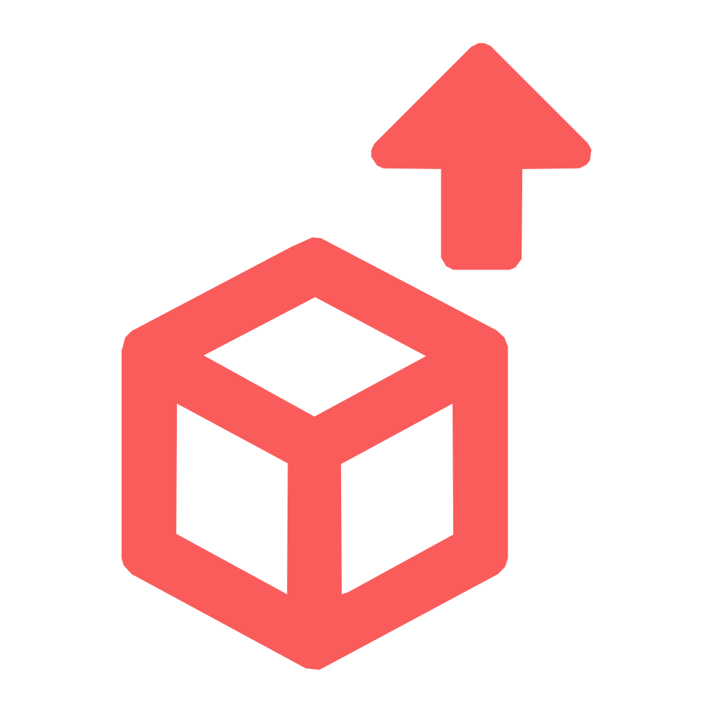
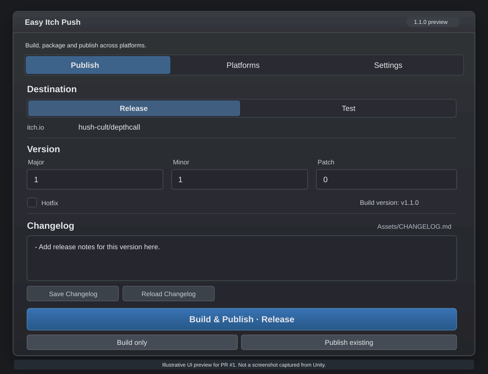

# Unity Easy Itch Push

<p align="center">
  
</p>

Unity Editor plugin for building multiple platform profiles and publishing versioned archives to itch.io with Butler.

## Install

Install through Unity Package Manager:

```text
https://github.com/NnicanBuak/unity-easy-itch-push.git
```

In Unity open `Window > Package Manager > + > Add package from git URL...` and paste that URL.

## Interface layout preview



*Illustrative layout for the draft PR, not a screenshot captured from Unity. Replace after a real Unity Editor test.*

## Redesigned Unity UI and release history

The plugin uses four focused tabs:

- **Publish:** destination, version, enabled platform summary, and build/publish actions.
- **Changelog:** dedicated editor for the current version's `Assets/CHANGELOG.md` section.
- **History:** persistent log of Butler publications, with release notes as they were when each version was uploaded.
- **Settings:** itch.io accounts, platform channels and build locations, GitHub Actions configuration and advanced tools.

New publication records are stored at `ProjectSettings/EasyItchPushReleaseHistory.json`. They survive editor restarts, include partial uploads and can be version-controlled with the project. Releases made before enabling the feature are not imported automatically.

## macOS IL2CPP via GitHub Actions

For a macOS Build Profile, choose **GitHub Actions (macOS)** under **Settings → Build profiles & channels**. Windows and WebGL can continue building locally.

Cloud builds require GitHub CLI, a clean pushed Unity game repository, a generated workflow in that project's `.github/workflows/` directory, and GameCI licensing secrets. The plugin downloads the macOS archive and uses the existing version checks and Butler publishing flow. See [Cloud build setup](Assets/Plugins/EasyItchPush/Documentation~/cloud-builds.md).

## What It Does

- Builds all enabled Unity Build Profiles in one run.
- Switches build targets automatically between profiles.
- Writes the configured game version into Player Settings and matching Build Profile settings.
- Saves version changes immediately from the plugin UI so they stay synchronized with the project.
- Creates versioned zip archives per platform after each successful build.
- Creates `Assets/CHANGELOG.md` automatically if the project does not have one yet.
- Uses `Assets/CHANGELOG.md` as the single changelog source and cuts the matching version section into each generated build `CHANGELOG.md`.
- Lets you edit the current version changelog directly in the Easy Itch Push window.
- Can inject the current version changelog into already built current-version archives without rebuilding.
- Validates build outputs before upload, including archive version consistency and HTML5 archive structure.
- Pushes release or test builds to itch.io through Butler.
- Logs all plugin activity to the Unity Console and to daily log files.

## Main Features

### Build All Profiles

The plugin discovers enabled Unity Build Profiles and builds them sequentially. Platform outputs are written into per-channel folders such as:

- `Builds/windows/latest/`
- `Builds/html5/latest/`
- `Builds/linux/latest/`

After each successful build, the plugin creates a versioned archive in the platform folder, for example:

- `Builds/windows/MyGame-Windows-v1.2.3.zip`

### Build Profiles as Source of Truth

The plugin is designed to respect Unity Build Profile platform settings. It updates version data for the active profile without blindly overriding every platform-specific Player Settings value.

### Release and Test Push Modes

The plugin supports separate publishing targets for release and test workflows:

- Different itch usernames, project slugs, and project IDs
- Different remote channel resolution rules
- Shared archive validation before upload

### Push Validation

Before Butler upload, the plugin checks:

- Required itch.io fields are filled
- Archives exist for every required platform
- Archive versions match the configured plugin version
- HTML5 archives contain `index.html` at the archive root
- Partial multi-platform releases are blocked

### Logging

Plugin logs are written to:

- Unity Console
- `logs/EasyItchPush/` daily log files

This helps preserve build diagnostics even when Unity clears console output during platform switches.

## Setup

1. Install the package from the git URL above.
2. Open `Project Settings > Easy Itch Push`.
3. Configure release and/or test itch.io destinations in the **Settings** tab.
4. Set the project version in **Publish**, and edit its release notes in **Changelog**.
5. Enable the desired Unity Build Profiles under **Settings → Build profiles & channels**.
6. Install Butler from `Tools > Easy Itch Push > Install / Upgrade Butler`.
7. Log in through `Tools > Easy Itch Push > Login`.

## Requirements

- Unity project using Build Profiles
- Butler for itch.io uploads
- Valid itch.io credentials and project configuration

## Typical Workflows

### Manual Review

1. Run `Build All Profiles`.
2. Check the generated archives.
3. If you edit the changelog after building, run `Update Existing Build Changelogs`.
4. Run `Push Existing`.

### Full Automation

1. Run `Build All Profiles and Push`.

## Notes

- The plugin can build locally without uploading.
- Pushes use versioned zip archives instead of raw build folders.
- The plugin supports mixed local/cloud builds and stores publishing history in the Unity project.
- History records only publications made through this plugin after the feature was installed.
